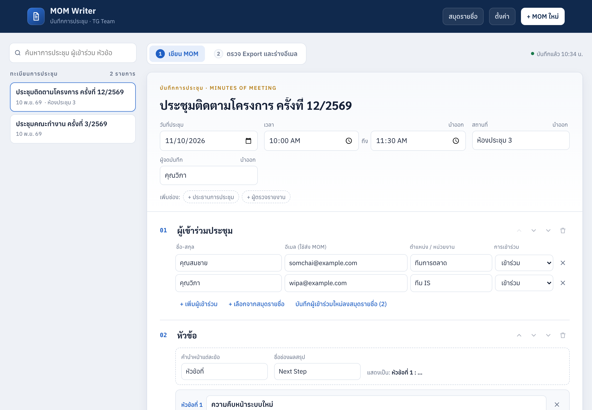
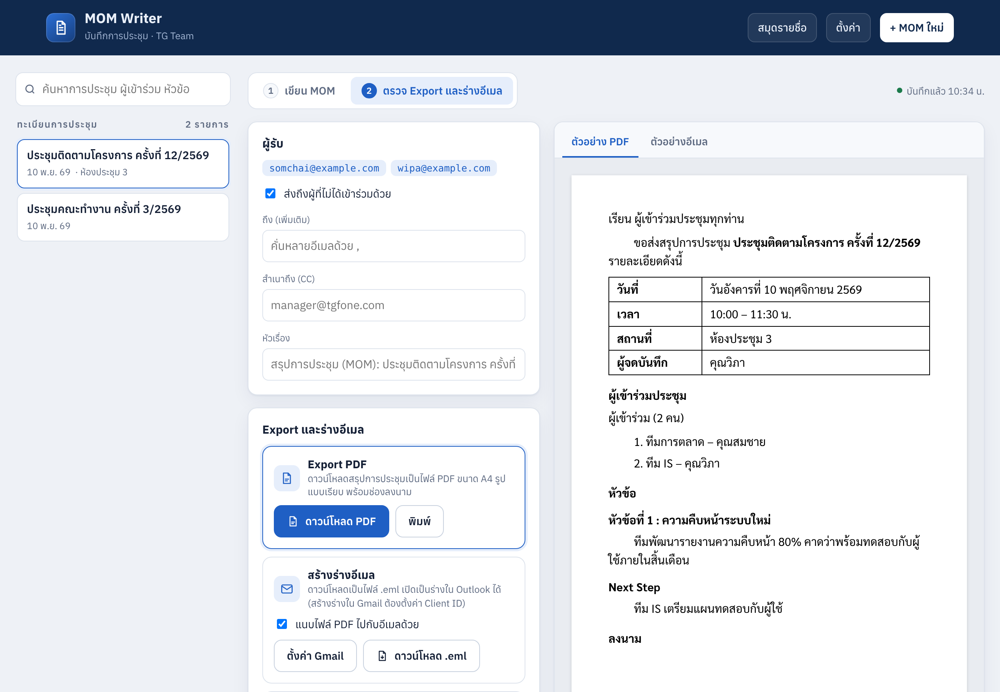

# MOM Writer

เว็บสำหรับเขียนบันทึกการประชุม (Minutes of Meeting) ของ TG Team เก็บไว้ในฐานข้อมูลกลางของทีม แล้ว Export เป็น PDF หรือสร้างร่างอีเมลส่งให้ผู้เข้าร่วมประชุม

- **Frontend:** `index.html` ไฟล์เดียว (HTML + CSS + JavaScript ไม่มีขั้นตอน build)
- **Backend:** PHP 8.0+ (PDO MySQL) ในโฟลเดอร์ `api/`
- **Database:** MySQL 5.7.8+ / 8.x หรือ MariaDB 10.3+
- **ไม่มีระบบ login:** ออกแบบให้ใช้ภายในเครือข่ายบริษัท (LAN / VPN) ทุกคนที่เข้าเว็บได้จะเห็นและแก้ไข MOM ได้ทั้งหมด




## ความสามารถ

- **ทะเบียนการประชุม:** รายการ MOM ทั้งหมดของทีม ค้นหาได้จากชื่อการประชุม ผู้เข้าร่วม หัวข้อ และงาน แสดงจำนวนงานค้าง
- **บันทึกอัตโนมัติ:** บันทึกลงฐานข้อมูลเองหลังหยุดพิมพ์ประมาณ 1 วินาที (เริ่มบันทึกเมื่อใส่ชื่อการประชุม) ถ้ามีคนแก้ MOM เดียวกันจากอีกเครื่อง ระบบจะไม่บันทึกทับ แต่ให้เลือกโหลดฉบับล่าสุดหรือบันทึกทับ
- **ลบและกู้คืน:** ลบ MOM ได้ และกด "เลิกทำ" ได้ (ลบแบบ soft delete ข้อมูลยังอยู่ในตาราง)
- **ทำสำเนาเป็นการประชุมครั้งถัดไป:** ยกรายชื่อผู้เข้าร่วม หัวข้อ และงานที่ยังไม่เสร็จมาให้
- **สมุดรายชื่อ:** เก็บชื่อ อีเมล ตำแหน่ง เลือกใส่ผู้เข้าร่วมได้หลายคนในครั้งเดียว พิมพ์ชื่อแล้วเติมอีเมลให้อัตโนมัติ และบันทึกผู้เข้าร่วมใหม่ลงสมุดรายชื่อได้ด้วยคลิกเดียว
- **ปรับหัวข้อได้อิสระ:** เปลี่ยนชื่อ เลื่อนลำดับ ย่อ นำออก เพิ่มหัวข้อกำหนดเอง ซ่อนหรือแสดงช่องข้อมูลการประชุม
- **ปรับคำในหัวข้อวาระ:** คำนำหน้าแต่ละข้อ (`วาระที่`, `หัวข้อที่`, `เรื่องที่` หรือเว้นว่าง) และชื่อช่องผลสรุป (`มติที่ประชุม`, `Next Step` ฯลฯ)
- **ช่องลงนาม:** ตำแหน่ง ชื่อ วันที่ และลายเซ็น (วาด หรืออัปโหลดรูป)
- **Export PDF:** ไฟล์ A4 รูปแบบเรียบ สร้างในเบราว์เซอร์ พร้อมเลขหน้า
- **ร่างอีเมล:** สร้างร่างใน Gmail ผ่าน Gmail API, ดาวน์โหลด `.eml` สำหรับ Outlook (ทั้งสองแบบแนบ PDF ได้) หรือเปิดหน้าเขียนอีเมล Gmail / Outlook บนเว็บ
- **ใช้งานได้แม้ฐานข้อมูลล่ม:** ถ้าเรียก API ไม่ได้ เว็บจะทำงานแบบไม่บันทึกข้อมูล (ซ่อนทะเบียนและสมุดรายชื่อ และแจ้งเตือนให้ Export PDF ก่อนปิดหน้า)

## โครงสร้างไฟล์

```
index.html              หน้าเว็บทั้งหมด
api/
  _bootstrap.php        เชื่อมต่อฐานข้อมูล, helper (เรียกตรงจากเว็บไม่ได้)
  config.example.php    ตัวอย่างค่าการเชื่อมต่อ -> คัดลอกเป็น config.php
  health.php            GET ตรวจว่าเชื่อมฐานข้อมูลได้
  moms.php              CRUD บันทึกการประชุม
  contacts.php          CRUD สมุดรายชื่อ
  .htaccess             ปิดการเข้าถึง config และ bootstrap (Apache)
database/schema.sql     สร้างฐานข้อมูลและตาราง
vendor/                 html2pdf.js 0.14.0 (MIT)
fonts/                  Sarabun, Anuphan (SIL OFL 1.1)
Dockerfile, docker-compose.yml   สภาพแวดล้อมทดสอบ
```

## Deploy บนเซิร์ฟเวอร์ PHP + MySQL

1. **สร้างฐานข้อมูล**

   ```bash
   mysql -u root -p < database/schema.sql
   ```

   แล้วสร้างผู้ใช้สำหรับแอป (ให้สิทธิ์แค่ SELECT, INSERT, UPDATE, DELETE):

   ```sql
   CREATE USER 'mom'@'localhost' IDENTIFIED BY 'รหัสผ่านที่ปลอดภัย';
   GRANT SELECT, INSERT, UPDATE, DELETE ON mom_writer.* TO 'mom'@'localhost';
   ```

2. **วางไฟล์** ทั้งโฟลเดอร์ไว้ใน document root ของเว็บเซิร์ฟเวอร์ (เช่น `/var/www/html/mom/`)

3. **ตั้งค่าการเชื่อมต่อ**

   ```bash
   cp api/config.example.php api/config.php
   ```

   แก้ host, ชื่อฐานข้อมูล, user, password ใน `api/config.php` (ไฟล์นี้อยู่ใน `.gitignore`) หรือกำหนดผ่าน environment variables `DB_HOST`, `DB_PORT`, `DB_NAME`, `DB_USER`, `DB_PASS` แทนได้

4. **ตรวจสอบ** เปิด `https://<โดเมน>/mom/api/health.php` ต้องได้ `{"ok":true}`

5. **ความปลอดภัย**
   - Apache: ต้องเปิด `AllowOverride` ให้ `.htaccess` ทำงาน (กันการเข้าถึง `config.php`)
   - Nginx / IIS: ตั้ง rule ปฏิเสธ `api/config.php`, `api/config.example.php`, `api/_bootstrap.php` และโฟลเดอร์ `database/`
   - เนื่องจากไม่มี login ควรเปิดให้เข้าได้เฉพาะในเครือข่ายบริษัท (firewall, VPN หรือ IP allowlist)
   - ใช้ HTTPS

PHP ต้องมี extension `pdo_mysql`, `mbstring` และ `json`

### ทดสอบด้วย Docker

```bash
docker compose up -d --build
# เปิด http://localhost:8080
```

ตารางจะถูกสร้างจาก `database/schema.sql` อัตโนมัติในการรันครั้งแรก (รหัสผ่านใน `docker-compose.yml` ใช้สำหรับทดสอบเท่านั้น)

### ค่าเริ่มต้นฝั่งหน้าเว็บ

แก้บล็อก `CONFIG` ด้านบนของ `<script>` ใน `index.html`:

```js
const CONFIG = {
  GMAIL_CLIENT_ID: '',   // Google OAuth Client ID สำหรับปุ่ม "สร้างร่างใน Gmail"
  SENDER_NAME: '',       // ชื่อลงท้ายเอกสารและอีเมล
  CLOSING: 'ขอแสดงความนับถือ',
  REPLY_NOTE: 'หากมีข้อแก้ไขหรือข้อเพิ่มเติม กรุณาแจ้งกลับภายใน 2 วันทำการ',
  PDF_GREETING: true,    // ใส่คำขึ้นต้นและคำลงท้ายแบบจดหมายใน PDF
  API_BASE: 'api/'       // ที่อยู่ของ PHP API
};
```

### Gmail API (ไม่บังคับ)

1. [Google Cloud Console](https://console.cloud.google.com) → APIs & Services → เปิดใช้ **Gmail API**
2. **OAuth consent screen** → User type **Internal**
3. **Credentials → OAuth client ID** → **Web application** → Authorized JavaScript origins ใส่โดเมนที่ deploy
4. ใส่ Client ID ใน `CONFIG.GMAIL_CLIENT_ID`

## API

ทุก endpoint รับและส่ง JSON (UTF-8) ข้อผิดพลาดตอบเป็น `{"error": "<code>", "message": "<ข้อความภาษาไทย>"}`

| Method | Path | ใช้ทำอะไร |
|---|---|---|
| GET | `api/moms.php?q=&limit=&offset=` | รายการ MOM (ล่าสุดก่อน) `{items, total}` |
| GET | `api/moms.php?id=1` | MOM หนึ่งรายการพร้อม `data` เต็ม |
| POST | `api/moms.php` `{data}` | สร้าง → `{id, version, updated_at}` |
| PUT | `api/moms.php?id=1` `{data, version, force?}` | แก้ไข ถ้า `version` ไม่ตรงตอบ `409 conflict` (ยกเว้น `force: true`) |
| DELETE | `api/moms.php?id=1` | ลบ (soft delete) |
| POST | `api/moms.php?id=1&action=restore` | กู้คืนรายการที่ลบ |
| GET | `api/contacts.php?q=` | รายชื่อทั้งหมด |
| POST | `api/contacts.php` `{name, email, role}` หรือ `{items:[...]}` | เพิ่ม ถ้าอีเมลซ้ำจะอัปเดตรายชื่อเดิม |
| PUT | `api/contacts.php?id=1` `{name, email, role}` | แก้ไข (`409` ถ้าอีเมลซ้ำกับรายชื่ออื่น) |
| DELETE | `api/contacts.php?id=1` | ลบ |

### ตาราง

- **`moms`** เก็บ MOM ทั้งฉบับเป็น JSON ในคอลัมน์ `data` (หัวข้อ ผู้เข้าร่วม วาระ งาน ลายเซ็นเป็นรูป base64) ส่วน `title`, `meeting_date`, `location`, `recorder`, `open_actions`, `search_text` เป็นค่าที่ API คัดลอกออกมาทุกครั้งที่บันทึก ใช้สำหรับแสดงรายการและค้นหา `version` ใช้กันการบันทึกทับกัน `deleted_at` ใช้ลบแบบกู้คืนได้
- **`contacts`** ชื่อ อีเมล (unique) ตำแหน่ง

## License ของส่วนประกอบภายนอก

- html2pdf.js: MIT (`vendor/html2pdf.LICENSE`)
- Sarabun, Anuphan: SIL Open Font License 1.1 (`fonts/OFL-*.txt`)
